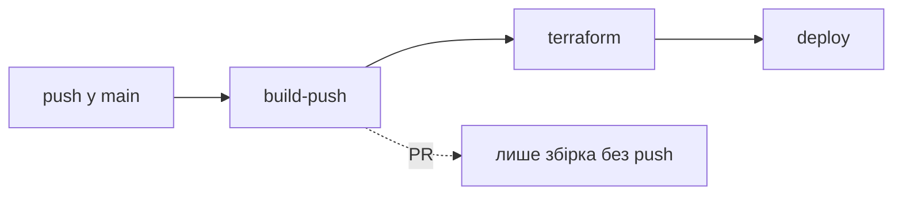

# devops: Node.js + PostgreSQL у Docker з CI/CD та Terraform

## Призначення

Невеликий Node.js-застосунок із базою PostgreSQL, запакований у Docker.
Повний цикл DevOps: push у `main` → збірка й публікація образу в Docker Hub →
створення інфраструктури в AWS через Terraform → запуск контейнерів на EC2 через Docker Compose.

Ендпоінти застосунку:

| Шлях      | Відповідь                                                        |
|-----------|------------------------------------------------------------------|
| `/`       | JSON із вітанням                                                 |
| `/health` | `{"status":"ok"}` (використовується в smoke-тесті)               |
| `/db`     | Перевірка підключення до PostgreSQL (`{"db":"ok"}`)              |

## Структура

```
students/maxdemir/
├── src/                        # код застосунку (index.js, package.json)
├── .github/workflows/          # воркфлов GitHub Actions (копія, див. примітку)
├── infra/                      # Terraform: main.tf, variables.tf, outputs.tf, user_data.sh
├── Dockerfile                  # multi-stage збірка
├── docker-compose.yml          # app + PostgreSQL (локально й на EC2)
├── .env.example                # приклад змінних середовища
├── .dockerignore
├── .gitignore
└── README.md
```

> **Примітка.** GitHub Actions запускає лише воркфлови з кореня репозиторію,
> тому активний файл лежить у `.github/workflows/maxdemir-deploy.yml` (корінь),
> а копія в `students/maxdemir/.github/workflows/` збережена за структурою завдання.
> Файли ідентичні; зміни вносьте в обидва.

## Локальний запуск

Потрібні Docker та Docker Compose.

```bash
cd students/maxdemir
cp .env.example .env            # за потреби змініть значення
docker compose up --build
```

Перевірка:

```bash
curl http://localhost:3000/
curl http://localhost:3000/health
curl http://localhost:3000/db
```

Зупинка: `docker compose down` (з видаленням даних БД: `docker compose down -v`).

## Змінні середовища

| Змінна              | За замовчуванням | Опис                                                  |
|---------------------|------------------|-------------------------------------------------------|
| `PORT`              | `3000`           | Порт застосунку в контейнері                          |
| `APP_PORT`          | `3000`           | Порт на хості (на EC2 CI ставить `80`)                |
| `DATABASE_URL`      | збирається compose | Рядок підключення до PostgreSQL                     |
| `POSTGRES_USER`     | `app`            | Користувач БД                                         |
| `POSTGRES_PASSWORD` | `app`            | Пароль БД (на EC2 береться з GitHub Secret)           |
| `POSTGRES_DB`       | `app`            | Назва БД                                              |
| `DOCKER_USERNAME`   | `local`          | Префікс образу `<user>/devops` (для pull на сервері) |

Файл `.env` не комітиться (див. `.gitignore`). На EC2 його створює пайплайн.

## Як працює пайплайн



1. **build-push**: збирає образ із `Dockerfile` і публікує в Docker Hub з тегами
   `latest` та `<commit sha>`. На pull request образ лише збирається (перевірка), без публікації.
2. **terraform**: `init` → `validate` → `apply`. Створює security group (порти 22 і 80)
   та EC2-інстанс Ubuntu 24.04 з наявною key pair. У `user_data.sh` при першому старті
   встановлюються Docker і Compose. State зберігається в S3, тому повторні запуски
   оновлюють наявну інфраструктуру, а не створюють нову. Публічний IP передається далі як output.
3. **deploy**: чекає готовності Docker на EC2, копіює `docker-compose.yml`, створює на сервері
   `.env` (пароль БД із секретів), робить `docker login`, `docker compose pull` і
   `docker compose up -d`, потім виконує smoke-тест `GET /health` на порту 80.

Прогрес видно у вкладці **Actions** репозиторію.

## Деплой

### Одноразова підготовка

1. У AWS (EC2 → Key Pairs) має існувати key pair `devops` у регіоні `eu-north-1`
   (назва задається змінною `key_name` у `infra/variables.tf`).
2. Створіть S3-бакет для Terraform state та впишіть його назву в `infra/main.tf`
   (`backend "s3"`). Регіон у `main.tf`, `variables.tf` і `AWS_DEFAULT_REGION` у workflow має збігатися.
3. Створіть токен у Docker Hub (Account settings → Personal access tokens, права Read & Write).
4. Закодуйте приватний ключ у base64 (один рядок):
   - Linux / Git Bash: `base64 -w0 devops.pem`
   - PowerShell: `[Convert]::ToBase64String([IO.File]::ReadAllBytes("devops.pem"))`
5. Додайте секрети: **Settings → Secrets and variables → Actions**.

### GitHub Secrets

| Секрет                  | Призначення                                              |
|-------------------------|----------------------------------------------------------|
| `DOCKER_USERNAME`       | Логін Docker Hub                                         |
| `DOCKER_TOKEN`          | Access token Docker Hub                                  |
| `AWS_ACCESS_KEY_ID`     | Ключ доступу AWS                                         |
| `AWS_SECRET_ACCESS_KEY` | Секретний ключ AWS                                       |
| `EC2_SSH_KEY_B64`       | Приватний ключ `devops.pem` у base64                    |
| `POSTGRES_PASSWORD`     | Пароль БД (літери й цифри, без спецсимволів в URL)       |

### Запуск деплою

```bash
git checkout -b feature/my-change
# ... зміни ...
git commit -m "feat: опис змін"
git push origin feature/my-change
# відкрийте Pull Request → після merge у main пайплайн запуститься сам
```

Адресу сервера покаже job `terraform` (output `public_ip`):

```bash
curl http://<public_ip>/health
curl http://<public_ip>/db
```

### Знищення інфраструктури

Щоб не платити за ресурси AWS:

```bash
cd students/maxdemir/infra
terraform init
terraform destroy
```

## Оптимізація Docker-образу

- multi-stage збірка: у фінальний образ потрапляють лише production-залежності;
- базовий образ `node:20-alpine` (малий розмір);
- `npm ci --omit=dev` + окремий шар для `package*.json` (кешування залежностей);
- `.dockerignore` виключає зайве з контексту збірки;
- запуск від непривілейованого користувача `node`;
- `HEALTHCHECK` у образі; кеш збірки в CI через GitHub Actions cache.

## Безпека

- Ключі, `.env`, `*.tfstate`, `.terraform/` виключені через `.gitignore`.
- Усі облікові дані зберігаються лише в GitHub Secrets.
- У навчальному прикладі порт 22 відкритий для всіх (`0.0.0.0/0`). У реальному проєкті обмежте його власним IP.
